It contains a list of various documents about feature extraction.  

### Fast Point Feature Histograms (FPFH)
* pcl::FPFHSignature33 is the default point type
* 33-byte = 11 bins (11 sub-divisions for each value) * 3 values ( $\alpha$, $\phi$, $\theta$ )  
* https://pcl.readthedocs.io/projects/tutorials/en/latest/fpfh_estimation.html
* https://pcl.readthedocs.io/projects/tutorials/en/latest/pfh_estimation.html#pfh-estimation
* https://adioshun.gitbooks.io/pcl/content/Tutorial/Feature/
* https://gnaseel.tistory.com/35

### TEASER (Truncated least squares Estimation And SEmidefinitie Relaxation)
* Fast and Certifiable 3D registration
* Implementation of FPFH, NCC(?)
* [Github (https://github.com/MIT-SPARK/TEASER-plusplus)](https://github.com/MIT-SPARK/TEASER-plusplus)
* [Youtube (https://www.youtube.com/watch?v=xib1RSUoeeQ)](https://www.youtube.com/watch?v=xib1RSUoeeQ)

|:Insight:|:Overview:|
|:------------------:|
|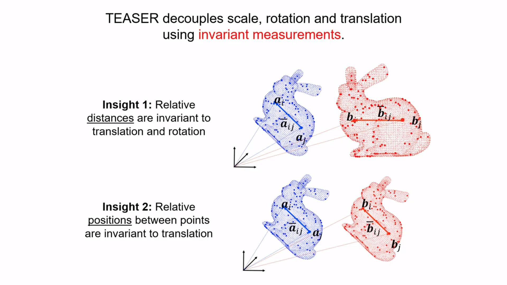|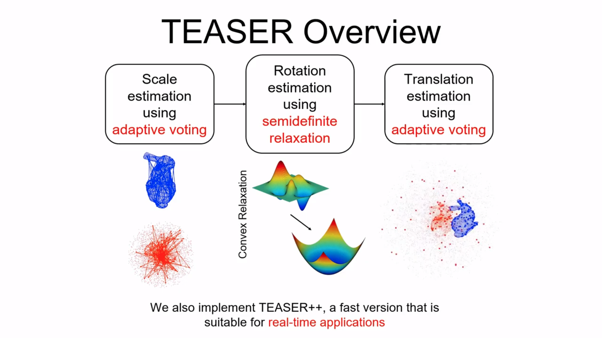|

* [Paper (https://arxiv.org/pdf/2001.07715.pdf)](https://arxiv.org/pdf/2001.07715.pdf)  
    * Overview
    1. Translation : TLS scale and translation estimation can be solved in polynomial time via an adaptive voting scheme. (Efficiency)
    2. Rotation : TLS rotation estimation can be relaxed to a semidefinite program(SDP) and the relaxation is tight, even in the presence of extreme outlier rates
    3. Graph-theoretic framework allows drastic pruning of outliers by finding the maximum clique.

    * Main Contributions 
        1. *Decouple Scale, Rotation, Translation*
        * Develop invariant measurements to estimate the scale
        * Decoupling formal (with noise(unknown/bounded))
        * Develop general graph-theoretic framework to dervie invariant measurements
        * This frameworks allows pruning a large amount of outliers by finding max clique of the graph by the invariant measurements

        2. *Adaptive Voting & SDP relaxation*
        * TLS estimation can be solved exactly in polynomial time using an *adaptive voting* scheme.
        * *SDP relaxation* to estimate the rotation
    
        3. Certifying the quality of solution
        4. TEASER++, a faster version
        5. Extensive evaluation

 
  
* Semidefinite program is a subfield of a convex optimization of linear objective function. [Conic_optimization](https://en.wikipedia.org/wiki/Conic_optimization)
* TEASER++ uses graduated non-convexity [Graduated_non-convexity](https://arxiv.org/pdf/1909.08605.pdf)

* Truncated Least Sqaures Registration Formula
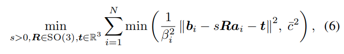

### Go-ICP
* Latest version : Jan. 2015
* [Github (https://github.com/yangjiaolong/Go-ICP)](https://github.com/yangjiaolong/Go-ICP)

### Fast Global Registration
* Using FPFH feature by applying TEASER
* [Paper (http://vladlen.info/papers/fast-global-registration.pdf)](http://vladlen.info/papers/fast-global-registration.pdf)
* Read 3.3 Correspondences (Poor correspondence matching method)

### MULLS (Multi-Metric Linear Least Square)
* Use TEASER with NCC feature
* Choose NCC feature rather than FPFH
* [Github (https://github.com/YuePanEdward/MULLS)](https://github.com/YuePanEdward/MULLS)
* Comparison (TEASER vs MULLS-ICP)

| |: TEASER results :|: MULLS results :|
|:---------------------------------:|
|: **overview** :|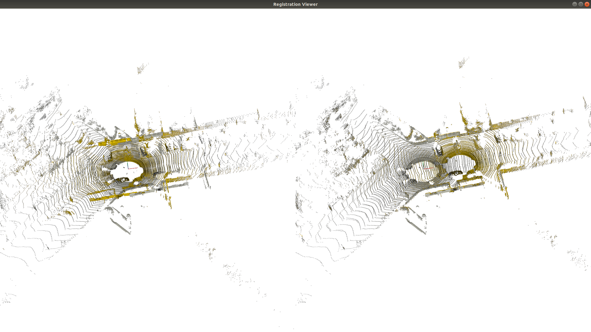|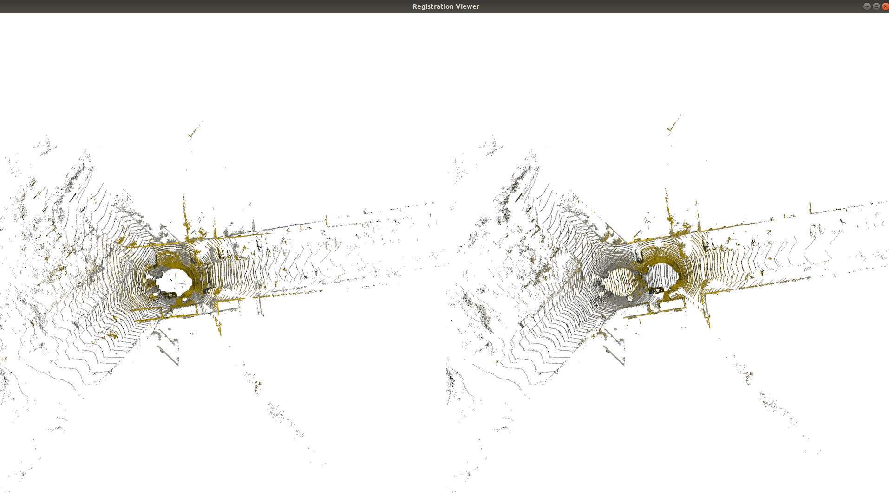|
|:---------------------------------:|
|: **scene 1** :|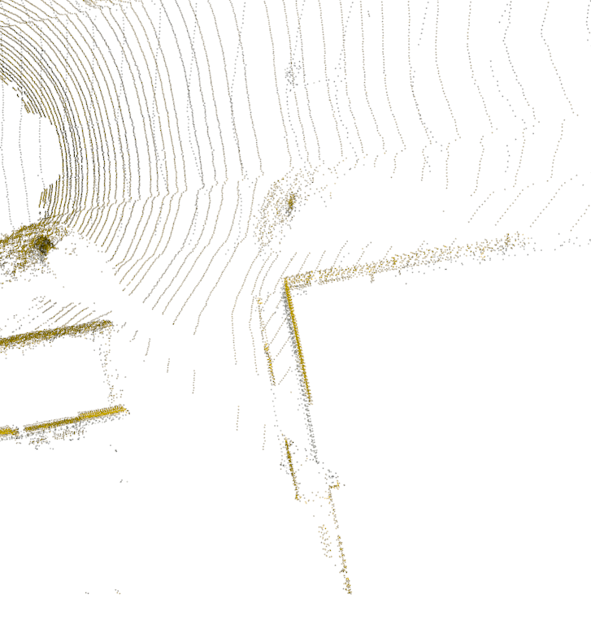|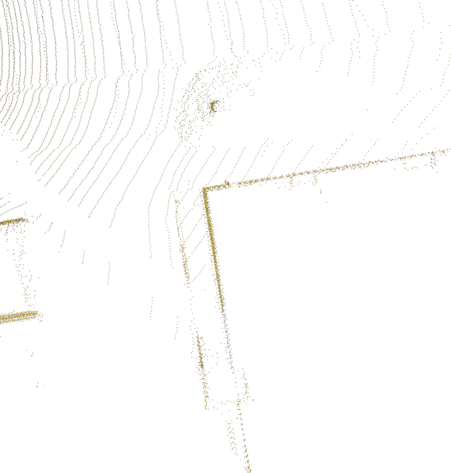|
|:---------------------------------:|
|: **scene 2** :|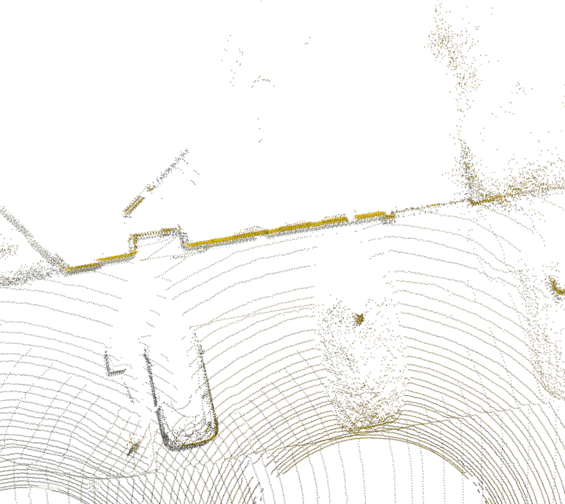|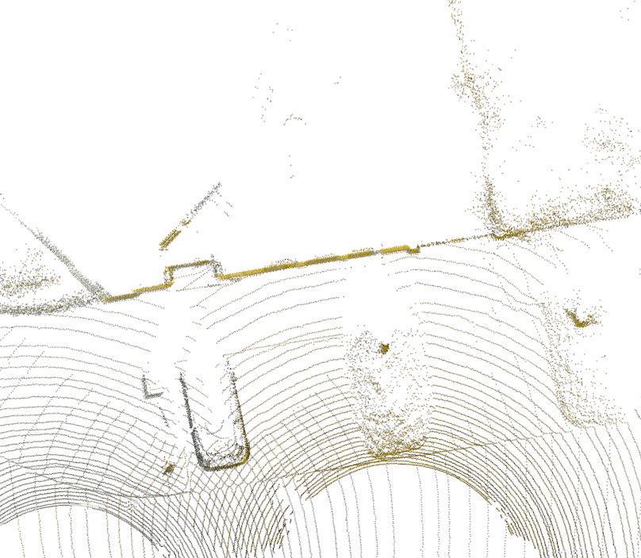|         
|:---------------------------------:|
|: **scene 3** :|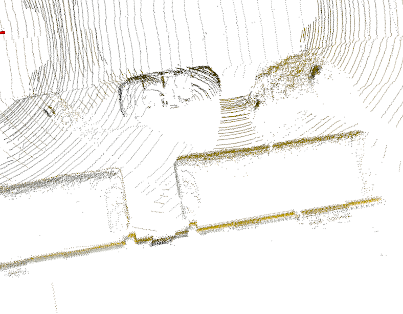|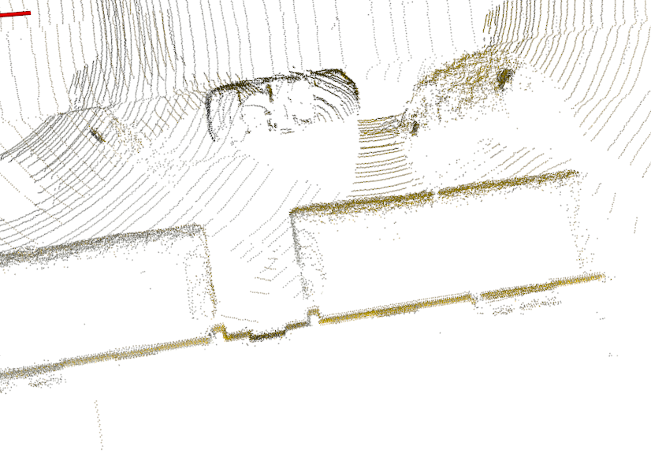|

### Neighborhood Context Category (NCC)  
* Not as descriptive as FPFH
* Generation is extremely fast

