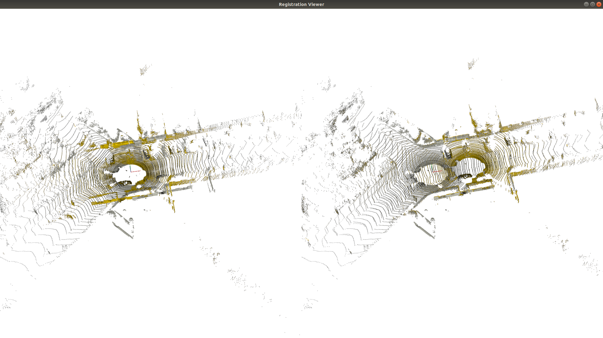
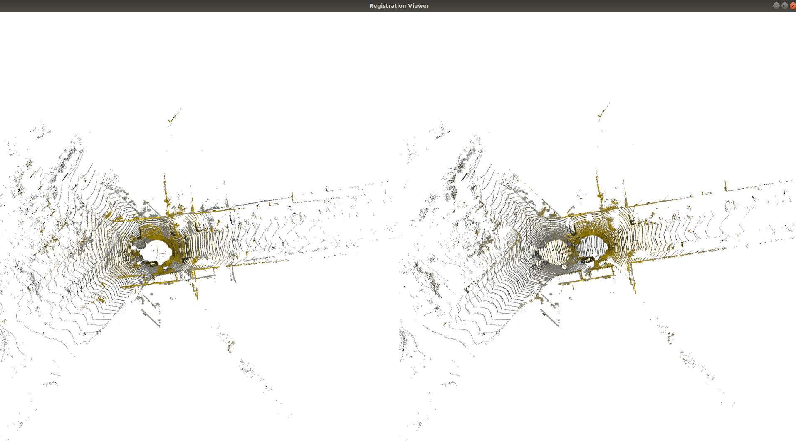
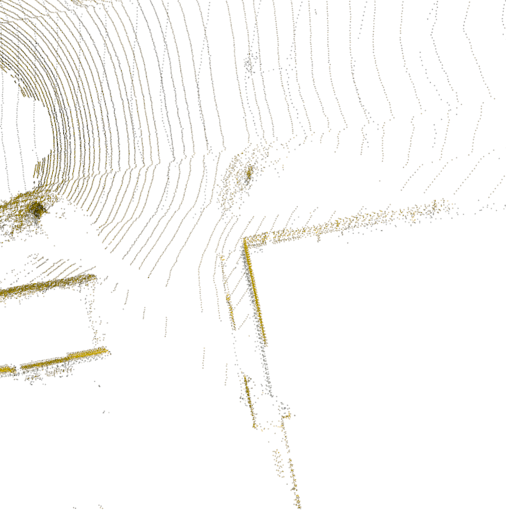
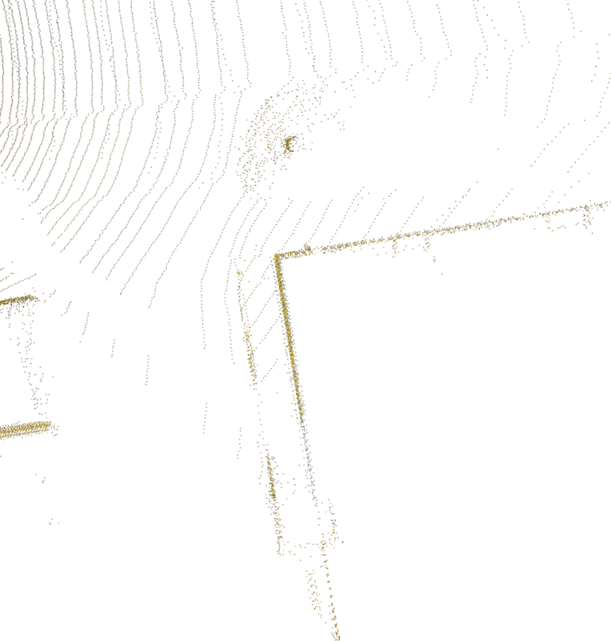
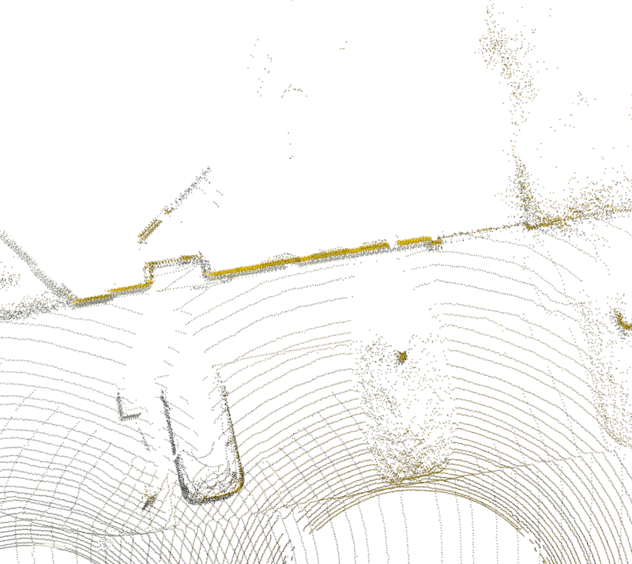
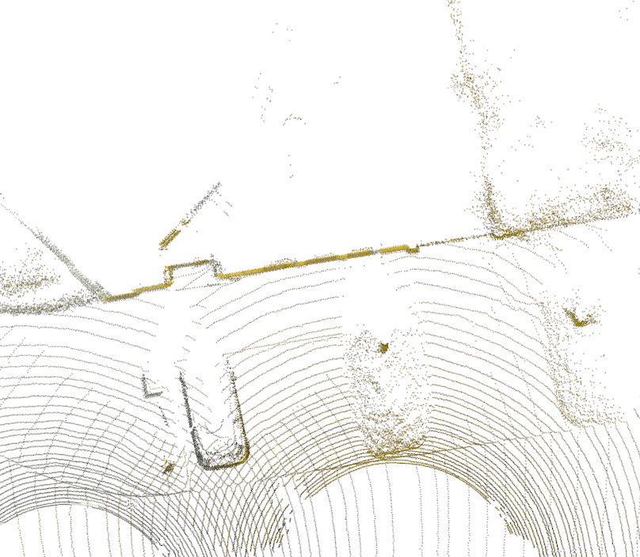
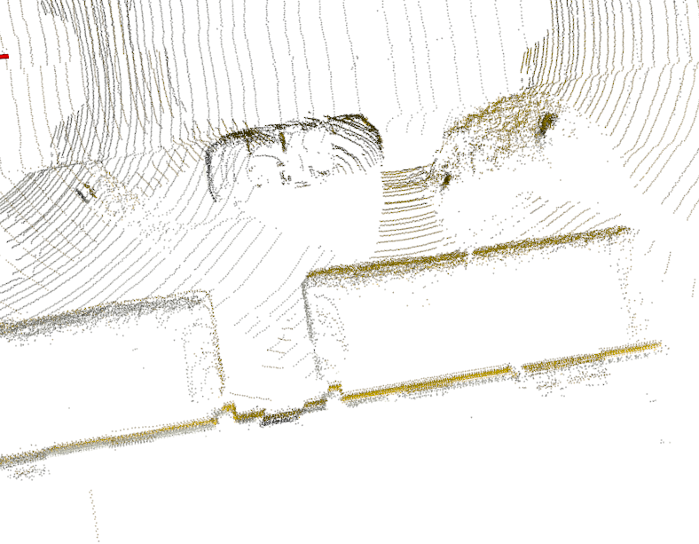
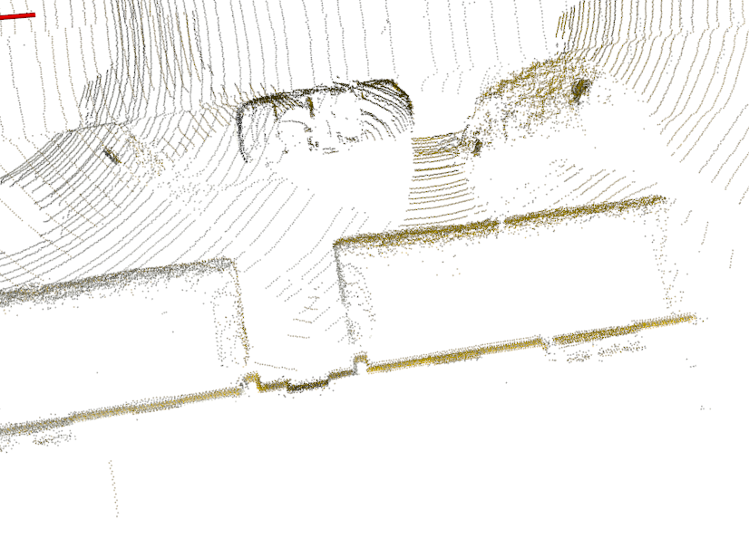

It contains a list of various documents

## Feature Extraction
How to extract features from pointcloud ...

### Fast Point Feature Histograms (FPFH)
* https://pcl.readthedocs.io/projects/tutorials/en/latest/fpfh_estimation.html
* https://pcl.readthedocs.io/projects/tutorials/en/latest/pfh_estimation.html#pfh-estimation
* https://adioshun.gitbooks.io/pcl/content/Tutorial/Feature/
* https://gnaseel.tistory.com/35

### TEASER (Truncated least squares Estimation And SEmidefinitie Relaxation)
* Fast and Certifiable 3D registration
* Implementation of FPFH, NCC(?)
* [Github](https://github.com/MIT-SPARK/TEASER-plusplus)
* [Paper](https://arxiv.org/pdf/2001.07715.pdf)

### Fast Global Registration
* Using FPFH feature by applying TEASER
* [Paper](http://vladlen.info/papers/fast-global-registration.pdf)
* Read 3.3 Correspondences (Poor correspondence matching method)

### MULLS (Multi-Metric Linear Least Square)
* Use TEASER with NCC feature
* Choose NCC feature rather than FPFH
* [Github](https://github.com/YuePanEdward/MULLS)
* Comparison (TEASER vs MULLS-ICP)

||:TEASER results:|: MULLS results:|
|---------------------------------|
|:**overview**:|||
|---------------------------------|
|:**scene 1**:|||
|---------------------------------|
|:**scene 2**:|||         
|---------------------------------|
|:**scene 3**:|||

### Neighborhood Context Category (NCC)  
* Not as descriptive as FPFH
* Generation is extremely fast

